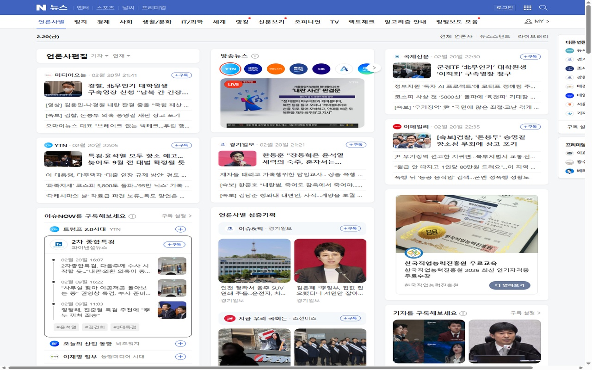
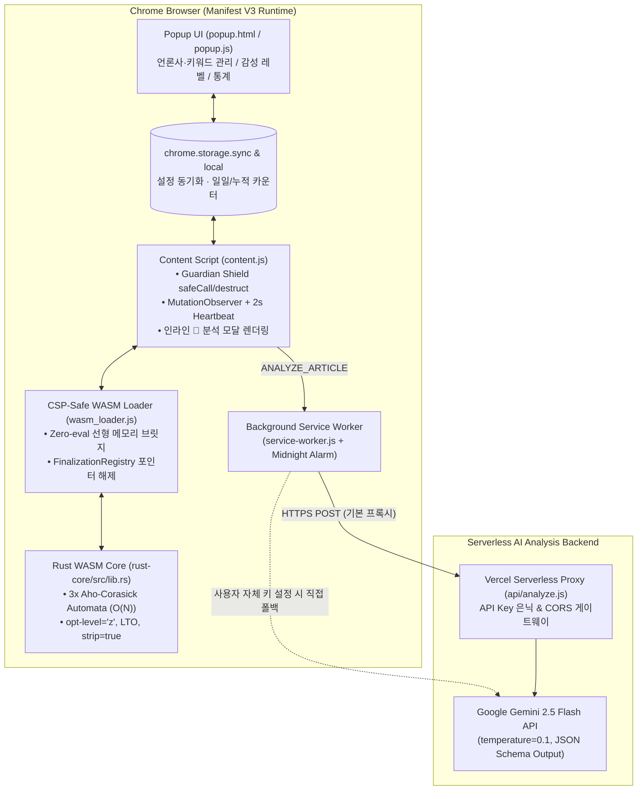

# 🧹 NNC: Naver News Cleaner Pro — Rust/WebAssembly 다중 패턴 필터링 & AI 뉴스 객관성 분석 확장 프로그램

[-4285F4?logo=googlechrome&logoColor=white)](./manifest.json)
[-DEA584?logo=rust&logoColor=black)](./rust-core/Cargo.toml)
[](./api/analyze.js)
[](./.github/workflows/main.yml)

> **네이버 뉴스(PC·모바일·통합검색)의 동적 DOM에서 원치 않는 언론사·키워드·자극적 어뷰징 기사를 무소음으로 즉시 제거하고, 원클릭 AI 객관성·편향성·팩트체크 리포트를 제공하는 Rust/WASM 하이브리드 Chrome 확장 프로그램입니다.**

---

## 1. Why — 배경 및 해결하려는 문제

포털 뉴스 소비 환경에서 기존 텍스트 차단 스크립트·확장 프로그램은 세 가지 기술적 한계를 드러냅니다.

1. **다중 키워드 증가 시 메인 스레드 프레임 드랍**: 차단할 언론사와 키워드가 수십~수백 개로 늘어날수록 무한 스크롤 DOM 변경마다 $O(M \times N)$ 문자열 순회가 발생해 브라우저 스크롤 버벅임을 유발합니다.
2. **동적 CSS 모듈 난독화 및 로고 이미지 우회 노출**: 네이버 뉴스 개편 이후 클래스명이 해시 모듈(`[class*="MediaItemView-module__media_item"]`)로 바뀌고 언론사명이 텍스트 대신 이미지 로고(`alt`/`title`)에만 들어 있는 영역이 많아 단순 셀렉터로는 누수가 발생합니다. 또한 확장 프로그램 재로드 시 기존 탭에 남은 스크립트가 `Extension context invalidated` 에러를 쏟는 문제가 흔합니다.
3. **클라이언트 API 키 노출 위험**: 확장 프로그램 번들 내부에 LLM API 키를 포함하면 누구나 패키지 압축 해제로 키를 탈취할 수 있습니다.

**NNC Pro**는 **① Rust `aho-corasick` 유한 상태 오토마타 + MV3 CSP-Safe WASM 로더**, **② 상향식(`Bottom-up`) 컨테이너 추적 및 자가 소멸(`Guardian Shield`) DOM 스캐너**, **③ Vercel 서버리스 프록시 기반 AI 뉴스 분석 파이프라인**으로 이 문제를 해결합니다.

---

## 2. What — 핵심 기능

- **언론사 & 키워드 무소음 차단 (`Sentinel Bottom-Up DOM Scanner`)**:
  - 본문 텍스트뿐 아니라 언론사 배지·로고의 `alt`, `title` 속성까지 역추적하여 상위 기사 카드 컨테이너(`article`, `.sa_item`, `MediaItemView-module` 등) 단위로 깔끔하게 숨깁니다.
  - 팝업 UI(`popup/popup.html`)에서 원클릭 주요 언론사 빠른 추가, 실시간 오늘 차단 수·누적 차단 통계 확인 및 자정 자동 일일 카운트 초기화(`chrome.alarms`)를 지원합니다.
- **Rust/WASM 고속 다중 패턴 & 감성 점수 엔진 (`rust-core/src/lib.rs`)**:
  - `AhoCorasick` 오토마타 3종(`source_matcher`, `keyword_matcher`, `sentiment_matcher`)을 빌드해 텍스트 길이에만 비례하는 단일 패스 $O(N)$ 매칭을 수행합니다.
  - 자극적·선정적 어휘 가중치 기반 부정 감성 점수(`calculate_sentiment_score`)와 사용자 정의 부정어 사전을 결합하여 단계별(`OFF` / `LOW: -20` / `HIGH: -10`) 자동 필터링을 지원합니다.
- **인라인 `🤖` AI 기사 객관성·편향성 분석 모달 (`content.js` ↔ `service-worker.js` ↔ `api/analyze.js`)**:
  - 각 뉴스 제목 우측에 자동 주입되는 `🤖` 버튼 클릭 시 기사의 **객관성 점수(`0~100점` 컬러 게이지), 편향성 등급 및 방향(`좌편향`/`우편향`/`상업적`/`중립`), 검증 필요 팩트체크 포인트, 한 줄 요약, 신뢰도 총평**을 오버레이 모달로 즉시 표시합니다.

| 메인 설정 팝업 화면 | 실시간 필터링 & AI 분석 동작 검증 |
| :---: | :---: |
|  |  |

---

## 3. How — 시스템 아키텍처 및 엔지니어링 상세

### 3.1 전체 아키텍처 다이어그램



### 3.2 핵심 기술적 의사결정 포인트

1. **Manifest V3 CSP 제약을 돌파하는 Zero-Eval 커스텀 WASM 로더 (`wasm/wasm_loader.js`)**:
   - `wasm-pack --target web`이 기본 생성하는 글루 코드는 ES Module(`export` / `import.meta.url`)에 의존하여 일반 Content Script에서 바로 실행되지 않으며, 동적 코드 실행(`eval` / `new Function`)은 MV3 Content Security Policy(CSP)에 의해 차단됩니다.
   - 이를 해결하기 위해 UTF-8 인코딩/디코딩 선형 메모리 전달(`passStringToWasm0` / `getStringFromWasm0`), 스택 포인터 복원(`finally`), GC 연동 자동 메모리 해제(`FinalizationRegistry -> __wbg_newsfilter_free`), 그리고 `WebAssembly.instantiateStreaming` 실패 시 `ArrayBuffer`로 자동 폴백하는 전용 래퍼를 직접 구현했습니다.
2. **Guardian Shield 컨텍스트 단절 방어 (`content/content.js`)**:
   - 확장 프로그램이 백그라운드에서 자동 업데이트되거나 재로드될 때 기존 열려 있던 뉴스 탭의 `MutationObserver`와 `setInterval`이 고아 상태가 되어 수천 건의 예외를 발생시키는 현상을 막기 위해, 모든 런타임 호출을 `safeCall()`로 감싸고 `chrome.runtime?.id` 소멸 즉시 옵저버·타이머를 영구 해체(`destruct()`)합니다.
3. **완전 자동화된 Rust → WASM → Chrome Web Store 배포 파이프라인 (`.github/workflows/main.yml`)**:
   - `master`/`main` 브랜치 푸시 시 GitHub Actions에서 `rust-toolchain` 및 `wasm-pack` 설치 → Jest(`jsdom`) 코어 로직 테스트 → WASM 릴리스 빌드(`opt-level = "z"`, LTO) 및 아이콘 생성 → `manifest.json` 버전 추출 패키징 → Chrome Web Store 자동 퍼블리시까지 단일 파이프라인으로 수행합니다.

### 3.3 디렉토리 구조

```text
naver-news-cleaner-pro/
├── manifest.json                  # Chrome Extension Manifest V3 설정 및 권한 선언
├── package.json                   # WASM 빌드, 아이콘 생성, Jest 테스트, ZIP 패키징 스크립트
├── rust-core/
│   ├── Cargo.toml                 # wasm-bindgen, aho-corasick, serde (LTO & size 최적화 프로파일)
│   └── src/lib.rs                 # NewsFilter 구조체 (언론사/키워드/감성 점수 Aho-Corasick 엔진)
├── wasm/
│   └── wasm_loader.js             # MV3 CSP-Safe WebAssembly 초기화 및 선형 메모리 브릿지
├── content/
│   └── content.js                 # Guardian Shield DOM 스캐너, 로고 역추적 차단 & 🤖 AI 결과 모달
├── background/
│   └── service-worker.js          # 메시지 브로커, 프록시/직접 Gemini 호출, 자정 알람 리셋
├── popup/
│   ├── popup.html / popup.css     # 확장 프로그램 설정 팝업 UI (언론사 / 키워드 / AI 분석 탭)
│   └── popup.js                   # 실시간 태그 추가·삭제 및 chrome.storage 동기화 컨트롤러
├── api/
│   └── analyze.js                 # API 키 보호용 Vercel Serverless Function (Gemini 2.5 Flash 중계)
├── tests/
│   ├── core.test.js               # Jest + jsdom 기반 필터링 대소문자/공백/체험기간 단위 테스트
│   └── mock-logic.js
└── .github/workflows/main.yml     # 테스트 → WASM 컴파일 → Chrome Web Store 자동 배포 CI/CD
```

---

## 4. Quick Start — 로컬 빌드·테스트 및 브라우저 장착 가이드

### 4.1 사전 요구 사항
- **Node.js** `v20+` 및 `npm`
- *(WASM 코어 재빌드 시)* **Rust (`cargo`)** + **`wasm-pack`** (`cargo install wasm-pack`)

### 4.2 단위 테스트 및 전체 빌드 실행

```bash
git clone https://github.com/tejo1990/naver-news-cleaner-pro.git
cd naver-news-cleaner-pro

# 1. 개발 의존성 설치 및 Jest 코어 필터링 단위 테스트 실행
npm install
npm test

# 2. Rust -> WebAssembly 릴리스 컴파일(wasm/pkg 생성) 및 아이콘 빌드
npm run build

# 3. 배포용 ZIP 아카이브 패키징 (선택)
npm run package
```

### 4.3 Chrome / Edge 브라우저 로컬 장착 (개발자 모드)

1. 위 `npm run build`를 실행해 `wasm/pkg/` 산출물을 생성합니다 *(또는 JS 폴백 필터만 테스트할 경우 클론 직후 바로 로드 가능)*.
2. Chrome 주소창에 `chrome://extensions` 입력 후 우측 상단 **[개발자 모드]** 토글을 켭니다.
3. **[압축해제된 확장 프로그램을 로드합니다 (Load unpacked)]** 클릭 → 클론한 `naver-news-cleaner-pro` 루트 폴더를 선택합니다.
4. `https://news.naver.com` 접속 후 우측 상단 확장 프로그램 팝업에서 차단 언론사/키워드를 등록하거나 기사 제목 옆 `🤖` 버튼을 눌러 동작을 확인합니다.

### 4.4 팝업 UI 단독 레이아웃 프리뷰 & AI 프록시 서버 배포 (선택)

```bash
# 팝업 UI 디자인만 브라우저에서 바로 미리보기
npx serve . -l 8091
# 접속: http://localhost:8091/popup/popup.html

# 자체 Vercel AI 분석 프록시 배포 시 환경변수 등록
# Vercel Dashboard -> Environment Variables -> GEMINI_API_KEY=<발급받은_키> 등록 후 배포
vercel --prod
```

---

## 5. 개인정보 처리방침 및 라이선스

- 사용자 차단 목록 및 통계는 브라우저 내부(`chrome.storage`)에만 저장되며 외부로 수집되지 않습니다. 자세한 내용은 [`PRIVACY_POLICY.md`](./PRIVACY_POLICY.md)를 참고하세요.
- Copyright (c) 2026. All rights reserved.
